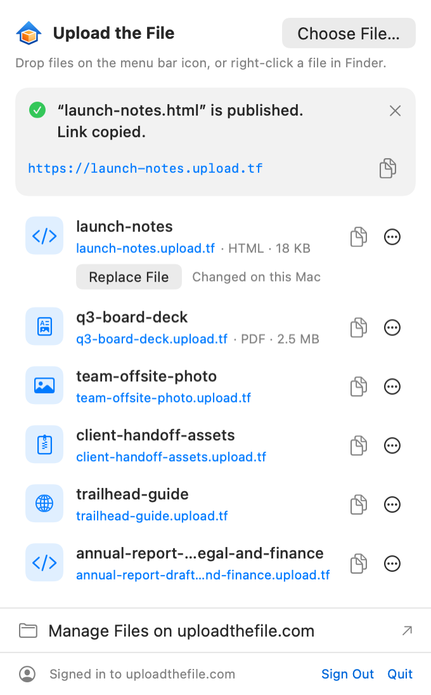
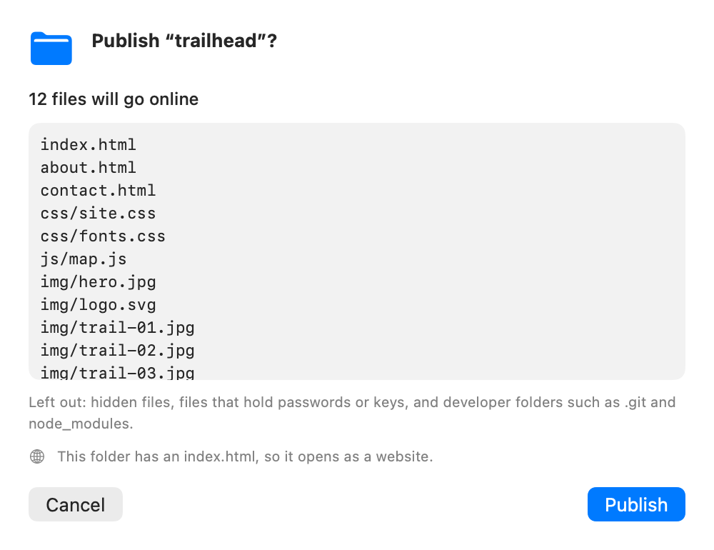
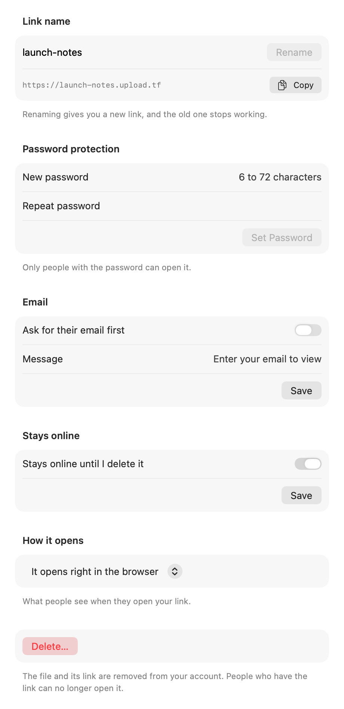

<p align="center">
  
</p>

<h1 align="center">Upload the File for Mac</h1>

<p align="center">
  Drop a file on your menu bar. Get a link. Send it.<br>
  A free, open-source Mac app for <a href="https://uploadthefile.com/?utm_source=github&amp;utm_medium=referral&amp;utm_campaign=uploadthefile_mac">uploadthefile.com</a>.
</p>

<p align="center">
  <a href="https://github.com/Smile-Mask-Technology/uploadthefile-mac/releases/latest/download/UploadTheFile.dmg"><b>Download for Mac</b></a>
  &nbsp;·&nbsp; macOS 14 or later &nbsp;·&nbsp; Apple silicon and Intel
</p>

<p align="center">
  <picture>
    <source media="(prefers-color-scheme: dark)" srcset="docs/images/menu-just-published-dark.png">
    
  </picture>
</p>

## What it does

- **Drop it on the menu bar.** Drag any file or folder onto the Upload the File icon. A moment
  later it's online and the link is on your clipboard, ready to paste into an email or a chat.
- **Right-click in Finder.** Choose **Publish with Upload the File** on any file or folder.
- **Whole websites too.** Drop a folder with an `index.html` and it opens as a website.
- **Same link, new version.** Changed the file? Click **Replace File** and everyone with the link
  sees the new version.
- **Your links, one click away.** Click a link to open it, click anywhere else on the row to copy
  it. **Manage Files on uploadthefile.com** opens your dashboard for QR codes, visits and more.
- **Set up each link.** Rename it, add a password, ask for their email first, choose how long it
  stays online and how it opens. Some of these come with the Pro plan.
- **Careful with your files.** Before a folder goes online you see exactly which files are
  included. Hidden files, passwords, keys and developer folders such as `.git` are left out.
- **Private.** You sign in once in your browser; the app never sees your password. No ads, no
  tracking.

<p align="center">
  <picture>
    <source media="(prefers-color-scheme: dark)" srcset="docs/images/publish-folder-dark.png">
    
  </picture>
  &nbsp;
  <picture>
    <source media="(prefers-color-scheme: dark)" srcset="docs/images/options-free-dark.png">
    
  </picture>
</p>

## Get started

1. **[Download the app](https://github.com/Smile-Mask-Technology/uploadthefile-mac/releases/latest/download/UploadTheFile.dmg)**,
   open the file and drag **Upload the File** into Applications.
2. Open it. Its icon appears in the menu bar.
3. Click the icon and **Sign In with Your Browser**. A free uploadthefile.com account is enough.
4. Drop a file on the icon. The link is copied.

Prefer [Homebrew](https://brew.sh)?

```sh
brew install --cask smile-mask-technology/tap/upload-the-file
```

The app is signed by Smile Mask Technology and notarized by Apple. Older versions and release notes
are on the [releases page](https://github.com/Smile-Mask-Technology/uploadthefile-mac/releases).

## From the terminal

The app comes with `uptf`, a command-line tool that does the same things (Homebrew puts it on your
path):

```sh
uptf login                          # sign in with your browser
uptf publish report.pdf             # publish a file; the link is printed and copied
uptf publish ./site                 # publish a folder; an index.html makes it a website
uptf update ./site                  # replace it and keep the same link
uptf ls                             # your links
uptf password report set            # add a password (asked without showing it)
uptf delete report                  # delete the file and its link
```

`uptf --help` lists every command.

## Questions

- **Is it free?** Yes, the app is free and open source. It works with a free uploadthefile.com
  account; a password, asking for an email and longer-lasting links come with the paid plans
  ([see plans](https://uploadthefile.com/pricing)).
- **How big can a file be?** Up to 50 MB from the app. For bigger files, use the website.
- **The Finder entry doesn't show.** Right-click a file and look under **Quick Actions** or
  **Services**. If it's missing, open System Settings ▸ Keyboard ▸ Keyboard Shortcuts ▸ Services
  and tick **Publish with Upload the File**. You can give it a keyboard shortcut there too.
- **Where is my data?** Your sign-in is kept in the macOS Keychain. The app remembers which file on
  your Mac belongs to which link, so it can offer **Replace File**. Files go only to
  uploadthefile.com, and only the ones you choose.
- **Found a security problem?** See [SECURITY.md](SECURITY.md).

## For developers

Building from source, the Swift library, the tests and releases: see
[docs/DEVELOPMENT.md](docs/DEVELOPMENT.md).

## License

MIT, see [LICENSE](LICENSE). © 2026 Smile Mask Technology.
